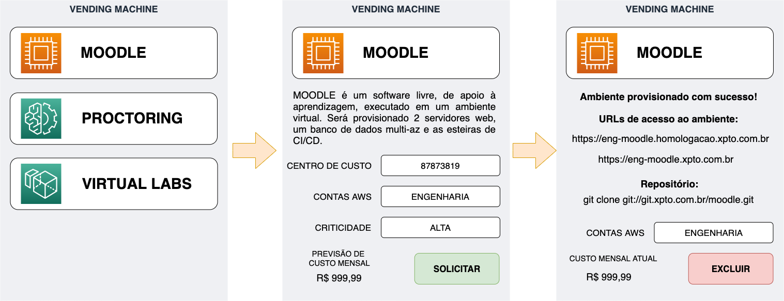
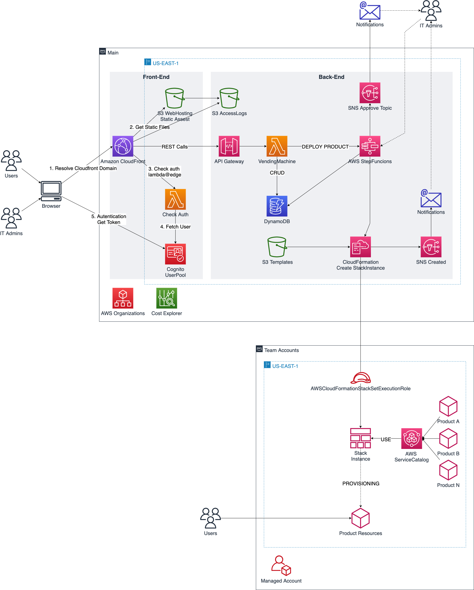

## aws-serverless-vending-machine

> **⚠️ This project is discontinued and no longer maintained.**
> The source code was removed. The last commit with the full implementation is [`893edb7`](https://github.com/aws-samples/aws-serverless-vending-machine/tree/893edb7). It is kept for reference only: it relies on end-of-life runtimes (Node.js 12, Amplify JS v4, Create React App) and should not be deployed.

This repository now documents the idea behind the project and points to current alternatives.

## The idea

Developer teams often need to open a ticket with IT or the Cloud Center of Excellence (CCoE) to get standard infrastructure, such as a workspace, a VPC, or an application stack with a CI/CD pipeline. The Vending Machine replaced that ticket with a self-service portal. Developers picked a pre-approved Infrastructure as Code (IaC) product, filled a short form, and the product was deployed to their AWS account.

<p align="center">

</p>

Two roles shared the portal:

- **CCoE / SysOps administrators** published products as CloudFormation templates, wrapped in an AWS Service Catalog portfolio shared across the AWS Organization. This kept standards (tags, networking, roles) in one place.
- **Developer teams** consumed those products without needing console access or knowledge of the underlying templates.

## Architecture

The solution was fully serverless, which kept it cheap and easy to operate.

<p align="center">

</p>

- **Frontend:** a React single-page app hosted on S3 and CloudFront, with Amazon Cognito authentication at the edge (Lambda@Edge).
- **API:** Amazon API Gateway (REST) secured by Cognito tokens, backed by AWS Lambda functions.
- **Orchestration:** AWS Step Functions ran the deployment flow, creating CloudFormation StackSet instances in the target accounts.
- **Storage:** Amazon DynamoDB stored the product catalog and the deployment requests; S3 stored the product templates, shared with the Organization by bucket policy.
- **Provisioning:** a Service Catalog baseline was deployed to every account through a StackSet, so each product was a `AWS::ServiceCatalog::CloudFormationProvisionedProduct` reused like a library.

## Product model

Each product was described by a JSON document. The portal built the request form dynamically from the `options` and `tags` blocks, so new products needed no frontend changes.

```json
{
  "name": "Workspace",
  "description": "Amazon WorkSpaces virtual desktop",
  "image": "workspace.png",
  "stack": {
    "stacksetName": "Workspace",
    "templateUrl": "https://<templates-bucket>.s3.amazonaws.com/products/product-workspace.yaml"
  },
  "options": [
    { "name": "User", "label": "User", "type": "text", "required": "true" }
  ],
  "tags": [
    { "name": "critical", "label": "Criticality", "type": "options", "values": ["High", "Medium", "Low"] },
    { "name": "costcenter", "label": "Cost center", "type": "text" }
  ]
}
```

- `options`: input parameters passed to the template. `type` is `text` (free field) or `options` (dropdown with `values`).
- `tags`: tags applied to every deployed resource, rendered the same way.

## Current alternatives

The self-service infrastructure problem is now covered by mature tools:

- **[AWS Service Catalog](https://aws.amazon.com/servicecatalog/)**: native end-user console and API to launch pre-approved products, with constraints, tag options, and portfolio sharing across the Organization. It covers most of what this project built by hand.
- **[AWS Control Tower Account Factory](https://docs.aws.amazon.com/controltower/latest/userguide/account-factory.html)** and **[Account Factory for Terraform (AFT)](https://docs.aws.amazon.com/controltower/latest/userguide/aft-overview.html)**: governed vending of new AWS accounts with baseline customizations.
- **[Backstage](https://backstage.io/)** (Software Templates): open source Internal Developer Portal for self-service scaffolding and infrastructure, with plugins for AWS.
- **[Port](https://www.port.io/)** and similar Internal Developer Portals: managed alternatives with self-service actions and a software catalog.

Note: AWS Proton, which also targeted this use case, [reached end of support on October 7, 2026](https://docs.aws.amazon.com/proton/latest/userguide/proton-end-of-support.html).

## Security

See [CONTRIBUTING](CONTRIBUTING.md#security-issue-notifications) for more information.

## License

This library is licensed under the MIT-0 License. See the LICENSE file.
